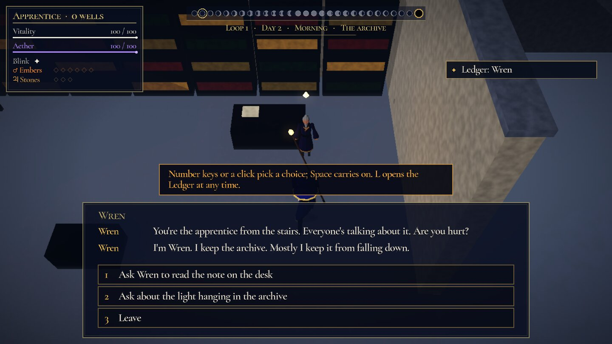
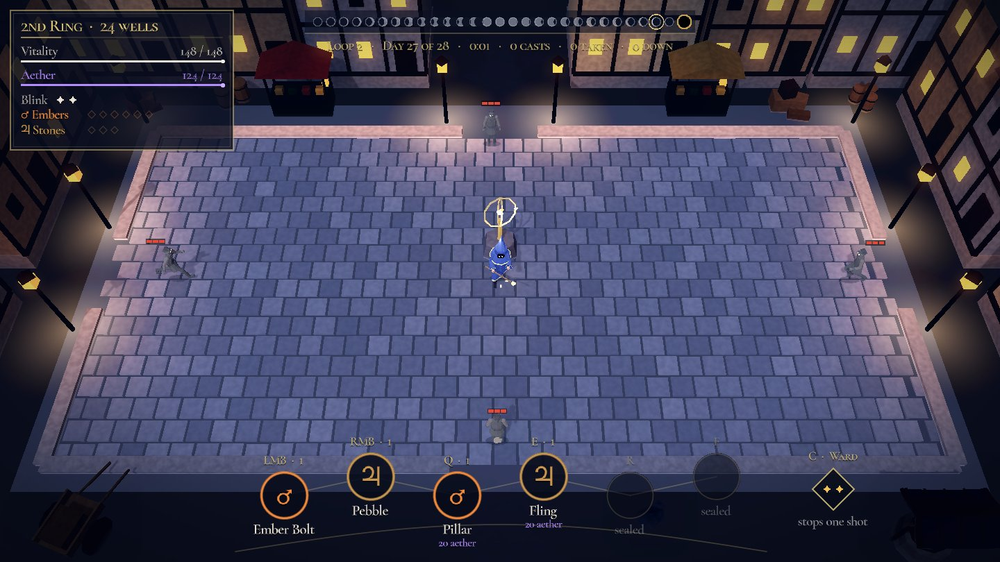

# Wizard: open-world prototype

**Days 1 to 7 of Vellmar's looping month, and one Long Night, in a town you walk.** You wake in a fire on the College stairs, then walk the streets with the clock running: people keep their own schedules, you talk to them where they stand, pick up and use things, and your spells touch the town (fire lights lamps and burns hay, water douses them, force shoves crates). Fights happen where you are. Loop 1 always ends at the north door on day 7, and you wake on day 1 remembering everything. Knowledge stays; power resets. Godot 4.7, GDScript, web export.

The design is the open-world spec in the project's `design/open-world/` (README: goals and criteria; `world.md`: the town, people and schedules; `interactions.md`: talking, items and magic in the world; `tech-plan.md`). It remakes the earlier vertical slice (`design/slice/`, milestones M1 to M5), keeping its story, Ledger, growth and fights. Milestones: **OW1**, the whole of days 1–7 and the Long Night playable by walking; **OW2**, the rest of the world's answers to magic (lightning, Rewind, lamplight, the barricade, people).



## Playing

- **Walk** with WASD (or League's click to move; **Tab** switches schemes). The camera is close and steep over the wizard; the town is lit by the moon, its lamps and your spells.
- **G** talks to the nearest person or uses the nearest item; their name shows when you're close. Scenes are a few lines and a choice: number keys pick, Space carries on. People say passing lines (barks) as you walk by.
- **The clock.** Each day runs Morning, Noon, Afternoon, Dusk and Night while you walk; people move between spots as it does. Sleep in your room to end the day. **M** opens a map of the town with what you know; click a place to walk there.
- **Magic in the world.** Ember Bolt lights a lamp or sets hay burning, Splash puts both out, a Pebble shoves a crate. Spark and Arc Lance make iron lamps flare and charge puddles, which then shock any Hollow standing in them; Rewind mends a burnt or shoved prop. Hollows won't step into a lit lamp's pool, so a lit street is a safe street at night (the tide at the north door is too many to care). Three crates or barrels shoved against the inside of the north door hold it on day 7, like the beam. People flinch and complain when you cast near them, the porter scolds fire in the College, and Mira thanks you for lighting her lane. Some things answer one element (an Ember Bolt on the Observatory wall teaches the scorch test; the second lantern won't go out).
- **Fights in place.** The patrol, the yard trial, the risen at the Mill, Silas and the tide at the north door start where you stand. A ring of mist holds you near where the fight began. Each has a knowledge route: the risen won't cross the millrace once Aldous has told you, Silas always opens with his lance, and the tide is barely survivable, so bar the door. **C** is the Ward: two charges, each stops one shot.
- **The Ledger** (L) keeps every clue, person, question and insight across loops; three questions are deductions. The death screen lists what you learnt that loop.
- **The Long Night** (day 27, if you survived day 7 with Wren as a friend): a censer fills with each of three topics you tell Wren.
- **Growth** (`scripts/game/growth.gd`, numbers in `data/slice/progression.json`): kills, patrols and meditating give wells; Rings open spellbook slots and spell tiers; everything resets when you wake but regrows faster (the Echo).
- **F4** switches graphics between high and low; **F8** mutes. The title, death and end screens have **Copy run summary** and **Feedback form** for playtesters.

## Where things are

- **The town:** `data/world/map.json` (streets, houses, places, the street graph, spots, lamps, props, items, fight spawns), `data/world/people.json` (figures, schedules, barks), `data/world/props.json`. `scripts/world/map.gd` handles collision and paths, `scripts/world/world.gd` the town's state each tick (clock, people, props, lamps, magic reactions), `scripts/world/town_mesh.gd` and `world_view.gd` draw it.
- **The story** is plain text in `data/world/story/*.story` (format in `scripts/game/story.gd`): scenes hang on a person (`talk:`), an item (`use:`, `cast:`) or a place (`arrive:`). Ledger entries are in `data/slice/ledger.json`, fights in `data/slice/encounters.json`.
- **The HUD** (`scripts/hud.gd`) draws its shapes as one triangle batch (`scripts/ui/tris.gd`) with the moons and spellbook cached, which keeps the browser's draw calls down.

## Checks

`tools/tests/route.gd` walks a bot (`tools/tests/walker.gd`) through loop 1 to the north door and loop 2 through the Long Night, with the clock running; `story_lint.gd` checks every scene, person, item and spot; `relearn.gd` checks a third loop regains the 3rd Ring by day 3; `deaths.gd` that each first death teaches something; `encounters.gd` fights every fight in its place, fresh and strong, and times the frames (8 ms p95); `world_magic.gd` casts real spells at lamps, hay, crates, puddles, people and the north door and checks each reaction; `cutscenes.gd` plays and skips the Fire. `tools/world_shot.gd` (needs a display) takes review screenshots and prints draw calls and lights at each.

## The fights

The fights are the spellbook prototype below, started from the story with an encounter from `data/slice/encounters.json`. A fight borrows the loop's Practice and spellbook: sealed slots wait for a Ring, the top left shows your Ring and wells, and C is the Ward instead of a Magick. It starts where you stand in the town; enemies come from doors and a ring around you, and a ring of mist (`leash`) holds you near where it began.



## Play it

- **In the browser:** every push to `main` publishes the web build to GitHub Pages (turn Pages on once: *Settings → Pages → Source: GitHub Actions*). Every PR also uploads the build as the `wizard-web` artifact; unzip it and run `python3 -m http.server` in the folder, then open http://localhost:8000.
- **In the editor:** open this folder in Godot 4.7 (standard edition) and press F5.
- **Export yourself:** `godot --headless --export-release "Web" export/web/index.html` (needs the 4.7.2 web export template).

## Controls

| Input | Slot |
| --- | --- |
| WASD | Move |
| Mouse | Aim |
| LMB, RMB, Q, E, R, F | The six **spellbook** slots. A Bolt fires while its slot is held; any other spell shows its telegraph while held and casts on release |
| C | The **Magick** of two spheres in the book. Locked until you discover it |
| G | The **Orrery** shrine, while the yard is quiet and you stand by it: change the spellbook and re-pick mutations |
| Space | Blink (charges grow with wizard level) |
| 1 / 2 | Pick a milestone mutation |
| F1 | Practice: every spell +1 level (to see milestones and mutations quickly) |
| F2 | Autoplay: a bot plays; press again to take over |
| F3 | Flip the light between the waves' night and the duel's deeper night (to compare them) |

**League-style controls.** Press Tab (on the title card, mid-fight or on the Ledger) to cycle Classic, League and League with smart cast (the choice is remembered). In League mode: right-click the ground to walk there (hold to keep following the cursor), right-click an enemy to walk into range and attack it with your Bolt, S to stop, Q W E R D F for the six slots (cast at the cursor), C for the Magick, Space to blink toward the cursor. With smart cast, spells go off the moment their key goes down, without the telegraph.

Holding a spell's slot shows the exact telegraph; the telegraph is the hitbox. Every shot also casts a ground shadow that is exactly its hitbox, so read where a shot will hit off the ground, not off the shot flying above it.

## Spellbook, Aether and Cadence

- **Spellbook.** Six slots, any six spells from any sphere; you start with the Mars and Jupiter kits. At the Orrery, pick a slot, then a spell (a spell already in the book swaps slots).
- **Aether** (the violet line under Vitality) is the mana: 100, refilling 12 a second. Bolts are free, Controls cost 20, Signatures 45 and Magicks 50 (written under each spell's star).
- **Cadence.** Casting the same spell again in a row dulls it by 15% a time, down to 55% (the red ×0.85 by its star). Changing spell, where at least one of the two is not a Bolt, adds a note (a star by the reticle) and refunds 10 Aether. With four notes the next non-Bolt spell is **Resonant**: 30% bigger, and one more bounce, strike or chain, previewed at its real size. Notes fade after 3 seconds without a cast.
- **Overdraw.** Short on Aether, a spell still casts: the missing Aether costs half as much HP, and the spell is locked for 10 seconds.
- **Fair telegraphs.** A circle telegraph never lands faster than a wizard-speed target can step out of it from the centre: 0.25 s + (radius + body) ÷ speed. Pillar's delay stops shrinking where that rule bites (about Lv 10).
- All of it is data in `data/spells.json` (`start_spellbook`, `aether`, `cadence`, `overdraw`, `dodge`).

## The four spheres

| Sphere | Bolt | Control | Signature | Field object |
| --- | --- | --- | --- | --- |
| **Mars** (was Fire) | Ember Bolt: adds a flame pip; 3 pips = **Ignite** | Pillar: a delayed fire column; adds 2 pips | Pyroclasm: bounces between pip-marked enemies | Embers (cap 6) |
| **Jupiter** (was Earth) | Pebble: heavy knockback; a hit drops a **lodestone** that orbits you | Fling: pushes your lodestones out in a cone | Avalanche: every lodestone slams one target | Lodestones (cap 3 to 7) |
| **Mercury** (was Storm) | Spark: an instant zig-zag to the nearest enemy in a cone, then chains | Arc Lance: hold to charge a line (you move slowly), release to strike along it | Storm Call: strikes on circles around the aim; the last leaves a **rod** | Lightning rods (cap 3): each zaps a nearby enemy |
| **Luna** (was Water) | Splash: a short spray that pushes and makes enemies **Wet** | Undertow: a wave that carries enemies and leaves a **puddle** | Maelstrom: a whirlpool that pulls enemies together | Puddles (cap 3): standing in one makes you Wet |

Wet enemies show a blue drip. Lightning that touches a wet enemy chains one hop further.

| Pair | Magick | Discover it by |
| --- | --- | --- |
| Mars + Jupiter | **Meteor**: lodestones ignite and fall as fireballs | Fire touching a lodestone (catch one in a Pillar) |
| Mercury + Luna | **Conductor**: a chain arc runs through every wet enemy in reach | Lightning striking a wet enemy |

A Magick is on C whenever spells of both its spheres are in the book. Other pairs have no Magick in the prototype yet; Magicks as fusion recipes come later.


## What to look for (the "readable" part)

- **Level-ups are visible.** A spell levels from its own hits. You get a toast with the stat change ("Speed 209 › 218"), the spell's star flashes, and for the next few casts a dashed ghost shows the *old* size: an old-speed ghost bolt that the new one outruns, the old Pillar radius, the old Fling cone.
- **Milestones at 5, 10 and 15** pause the fight for a pick between two mutations. The spell's name gets a small star; hover its star in the spellbook for its numbers and mutations. Ember Bolt usually reaches 5 in the first fight.
- **Field objects** are counted under Vitality and Aether, one row per sphere in the book that has one: lodestones (cap 3, Avalanche raises it to 7), embers (cap 6), rods (cap 3) and puddles (cap 3).
- **Impact vs Poise.** Hollows have Poise 0, Silas has Poise 1. Ember Bolt (Impact 1) only makes Silas show a small "x", Pebble (2) makes him flinch, Pillar (3) and a fully charged Arc Lance stagger him and break his wind-up; Updraft (4) knocks him down.
- **Enemy HP in chunks of 10.** Hovering an enemy shows hits-to-kill with the first Bolt in your book (×N).
- **Hit-stop and shake** scale with the share of the target's HP removed, not raw damage.
- **The loop as a measuring stick.** Spell levels, mutations, Magicks, tome hints and your spellbook carry over; the wizard level drops to half. The Ledger lists every loop with the pair you carried and draws a sparkline of win times.

## The design decisions, as built

1. **A six-spell spellbook from any sphere** (replaces "two elements equipped", 2026-10-15). You start with the Mars and Jupiter kits; the Mercury and Luna spells wait at the Orrery.
2. **Wizard level halves each loop** (rounded down, minimum 1). Spells keep their levels.
3. **The spellbook and milestone picks change only at an Orrery shrine.** The Orrery stands in the middle of the yard. Press G beside it while the yard is quiet (before the first wave and between waves) to fill the book's six slots and re-pick any mutation of the spells you carry. There is no free re-pick at the start of a loop.
4. **Magicks: discovery in combat, with tomes as hints.** A Magick unlocks only when its two elements meet in a fight. A tome lies by the fence in each loop while there is a Magick you have neither discovered nor read about; walking over it gives a hint ("Storm finds water"), shown under the Magick's diamond (C). Hints carry across loops; they never unlock the Magick themselves.

## The look

The art direction is locked in the GDD (`design/gdd/06-presentation-and-tech.md`, 6.3 and 6.6), picked by Harold from rated mockups on 2026-10-16: a **moody night** world and a **Star Atlas** interface.

- **The world at night.** Vellmar is cobbled streets after the "Moody night" mockup: moonlight (a dimmer grey daylight in the day's earlier times), a cool ambient, a low mist, two-storey timber houses with lit windows, market stalls, trees and clutter in the streets, and lamp posts whose light pools on the cobbles and walls. The wizard's staff gem carries a small warm light, so the player never vanishes, and the spells are the main light: Ember Bolt lights the ground as it flies. When Silas steps through the gate the night deepens and the spells glow harder. A dark vignette (a gradient drawn over the 3D, `"vignette"` in `data/visual.json`) and a muted grade (`"adjust"`) leave colour to the spheres, gold and the red of telegraphs. Walls between the camera and the wizard are cut away with a dither.
- **Models and materials.** Faceted low-poly shapes with matte materials: `scripts/view/lowpoly.gdshader` adds a faint bump from a shared noise normal map projected from the world axes and some albedo mottling; specular is kept almost off. The finishes (figure, prop, stone, metal, ground) are in `"surfaces"` in `data/visual.json`.
- **Kept cheap for the browser.** Everything that stands still (cobbles, kerb, houses, stalls, trees, props, lamps) is merged into three meshes with the colour in the vertices (`scripts/view/town.gd`). The lamps are not real lights: their warmth is baked into the vertex colours near them, and their pools are additive glows (`pool.gdshader`). Only the spells get real lights (at most four), the moon's shadow is a single pass, and the fonts are distance fields, so text never re-rasterises mid-fight. Only figures are drawn two-sided with the dithered fade; the town and the ground cull their back faces, and only the buildings on the line of sight to the wizard get the cutaway shader (`lowpoly_cut.gdshader`), because a shader that can `discard` stops the GPU skipping hidden pixels (`lowpoly_solid.gdshader` has no `discard`). `tools/world_shot.gd` prints draw calls and lights at each screenshot.
- **The interface.** Navy glass panels with gold hairlines, Cormorant Garamond and Cormorant SC (OFL, `assets/fonts/`), and the planets' glyphs (Noto Sans Symbols, subset). The spellbook is a constellation of six star rings in each sphere's colour, with the key and level above, the name and Aether cost below, a gold arc for the level's progress, a dark sweep for the cooldown and a gold halo when the cast will be Resonant; hover a star for the spell's numbers. The Magick is the gold diamond on the right. Vitality and Aether are fine lines top left; Cadence is four stars by the reticle; top centre, the loop's 28 days are moon phases ending in the Eclipse's black sun (the prototype's fight is always the first day). The duelist's plate is top right.
- **Spells** are still solid geometry, not particles: Ember Bolt is a comet (League of Legends' Brand Q as the reference) with a white-hot core and flame tongues streaming back, stones are rocks, Storm shots are crystals, lightning is a chain of thin prisms, and impacts throw shards that shrink away. Round the hot ones a soft halo (`halo.gdshader`) glows into the bloom.

The camera keeps the GDD lock (about 56 to 60 degrees down, 40 degree field of view), sits closer than the whole yard and drifts part of the way after the player. The figures and props are still the Wuxia game's low-poly models.

The sim is still the 2D one. `scripts/view/view3d.gd` reads it every frame and never changes it: the arena draws its flat marks (telegraphs, hold-to-aim previews, zones, effects, the reticle) into an offscreen viewport that lies on the ground as a decal, so a telegraph is still exactly the hitbox, and the view adds what stands up: figures, lodestones, projectiles, flames, rods, the Orrery, lightning. A shot's solid part is drawn at about its hitbox size, flying low (0.4 m), and only its halo and tail reach past it, the tail always behind; its ground shadow is the exact hitbox. Figures, hats, colours, the two moods, the surfaces, the mist, the town and the props are in `data/visual.json`; `"enabled": false` there brings back the old pixel arena.

The figures are Wuxia's models for now (the elder under a wide pointed hat as the wizard, ash-grey bandits with ember eyes as Hollows, a swordsman in a frontier hat as Silas). Western models of their own are the next step.

## Not in this prototype

Frost and Time, Magicks for the other pairs, relics and Focus, days 8 to 28, interiors beyond your room and the archive, and Silas as a full Storm kit (he only uses three of its moves). Three mutations differ from the design doc because the prototype has nothing for them to act on: Arc Lance's *Full charge pierces walls* is **Overcharge** (full charge deals double, the yard has no walls), Splash's *Spray heals ally echoes* is **Spillway** (Splash leaves a puddle, there are no echoes), and Maelstrom's *Combines with any Magick* counts everything in the whirlpool as wet for Conductor. All numbers are starting values in `data/spells.json`.

## Files

| File | What it does |
| --- | --- |
| `data/spells.json` | Every tuning number: elements, spells, stat tracks, milestones, Magicks, field objects, the shrine, enemies, reactions |
| `scripts/autoload/progression.gd` | Spell XP and levels, mutations and re-picks, mastery, the loadout, Magicks and tome hints, wizard level, loops, the Ledger, saving |
| `scripts/arena.gd` | The Mill fight: units, hits and reactions, pips and Ignite, Wet, projectiles, telegraphs, lodestones, the Orrery and tomes, drawing |
| `scripts/kit.gd` | The loadout: slots, input, casting, blink, hold-to-aim previews and level-up ghosts |
| `scripts/spells/fire_earth.gd` | Fire and Earth spells and Meteor |
| `scripts/spells/storm_water.gd` | Storm and Water spells, rods, puddles, the whirlpool and Conductor |
| `scripts/ai.gd` | Hollows, Slingers and Silas Vane |
| `scripts/hud.gd` | The Star Atlas HUD: the spellbook constellation and Magick diamond, Vitality and Aether, caps, Cadence stars, the moon row, the duelist's plate; toasts, milestone picker, the Orrery menu, title, Ledger |
| `data/visual.json` | The 3D view: figures (model, colours, hat), the two night moods, mist, vignette, surfaces, the ground, props, the town, camera |
| `scripts/view/view3d.gd` | The 3D view over the sim: camera, light, mist and mood, the ground, props, the marks decal, figures, the Orrery, the vignette |
| `scripts/view/town.gd` | The cobbled plaza and the edge of Vellmar round it, merged into three meshes, with lamp light baked in |
| `scripts/view/spells3d.gd` | Spells as low-poly shapes: the comet fireball, rocks, crystals, flames, pillars, the meteor, lightning, impact shards |
| `scripts/view/figure.gd` | One figure: the model with its materials and the shared surface finishes, hats and eyes, posed from the shared clip library |
| `scripts/view/marks.gd` | Flame pips, HP chunks, stun stars and Wet over heads, in screen space |
| `scripts/view/*.gdshader` | Low-poly shading (figures, props, ground, spells), spell halos and the marks decal |
| `assets/models/` | Figures, the clip library and props, from the Wuxia game |
| `scripts/pixel_art.gd` | The palette, and the pixel sprites the flat fallback still draws |
| `scripts/bot.gd` | The bot used by the fight test and F2 autoplay |
| `tools/world_shot.gd` | Screenshots across the town and the day, with draw calls and lights (needs a display; see its header) |
| `assets/fonts/` | Cormorant Garamond, Cormorant SC and a Noto Sans Symbols subset for the planets' glyphs (SIL Open Font License, texts alongside) |
| `tools/tests/` | The checks CI runs (see Tests above and `.github/workflows/ci.yml`) |

Progress saves to `user://progress.json` (in the browser, the site's IndexedDB). Delete twice on the Ledger screen wipes it.

## Tests

```
godot --headless --script res://tools/tests/unit.gd
godot --headless --fixed-fps 60 --script res://tools/tests/route.gd
godot --headless --fixed-fps 60 --script res://tools/tests/world_magic.gd
```

CI runs every check on every PR (via `tools/ci/godot.sh`, which also fails on script errors) and builds the web export.
