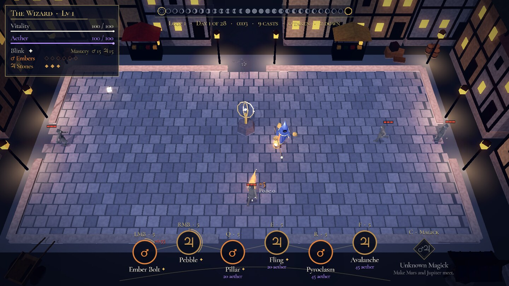
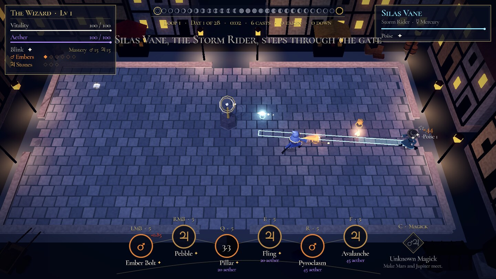

# Wizard: spellbook prototype

A small browser prototype of the wizard game. Magic comes from four of the planetary spheres, **Mars, Jupiter, Mercury and Luna** (they were Fire, Earth, Storm and Water). You carry a **spellbook** of any six spells from any sphere, pay for them in **Aether** (the mana), and **Cadence** rewards weaving different spells over spamming one. There are two Magicks (**Meteor** and **Conductor**), one fight (**Ambush at the Mill**), a moody night look with a star-atlas HUD, and progression you can see. Godot 4.7, GDScript, web export. The design is in the project's `design/magic-world-revisit.md` and `design/gdd/`.



## Play it

- **In the browser:** every push to `main` publishes the web build to GitHub Pages (turn Pages on once: *Settings → Pages → Source: GitHub Actions*). Every PR also uploads the build as the `wizard-web` artifact; unzip it and run `python3 -m http.server` in the folder, then open http://localhost:8000.
- **In the editor:** open this folder in Godot 4.7 (standard edition) and press F5.
- **Export yourself:** `godot --headless --export-release "Web" export/web/index.html` (needs the 4.7.2 web export template).

## Controls

| Input | Slot |
| --- | --- |
| WASD | Move |
| Mouse | Aim |
| LMB, RMB, Q, E, R, F | The six **spellbook** slots. A Bolt fires while its slot is held; any other spell shows its telegraph while held and casts on release |
| C | The **Magick** of two spheres in the book. Locked until you discover it |
| G | The **Orrery** shrine, while the yard is quiet and you stand by it: change the spellbook and re-pick mutations |
| Space | Blink (charges grow with wizard level) |
| 1 / 2 | Pick a milestone mutation |
| F1 | Practice: every spell +1 level (to see milestones and mutations quickly) |
| F2 | Autoplay: a bot plays; press again to take over |
| F3 | Flip the light between the waves' night and the duel's deeper night (to compare them) |

**League-style controls.** Press Tab (on the title card, mid-fight or on the Ledger) to cycle Classic, League and League with smart cast (the choice is remembered). In League mode: right-click the ground to walk there (hold to keep following the cursor), right-click an enemy to walk into range and attack it with your Bolt, S to stop, Q W E R D F for the six slots (cast at the cursor), C for the Magick, Space to blink toward the cursor. With smart cast, spells go off the moment their key goes down, without the telegraph.

Holding a spell's slot shows the exact telegraph; the telegraph is the hitbox. Every shot also casts a ground shadow that is exactly its hitbox, so read where a shot will hit off the ground, not off the shot flying above it.

## Spellbook, Aether and Cadence

- **Spellbook.** Six slots, any six spells from any sphere; you start with the Mars and Jupiter kits. At the Orrery, pick a slot, then a spell (a spell already in the book swaps slots).
- **Aether** (the violet line under Vitality) is the mana: 100, refilling 12 a second. Bolts are free, Controls cost 20, Signatures 45 and Magicks 50 (written under each spell's star).
- **Cadence.** Casting the same spell again in a row dulls it by 15% a time, down to 55% (the red ×0.85 by its star). Changing spell, where at least one of the two is not a Bolt, adds a note (a star by the reticle) and refunds 10 Aether. With four notes the next non-Bolt spell is **Resonant**: 30% bigger, and one more bounce, strike or chain, previewed at its real size. Notes fade after 3 seconds without a cast.
- **Overdraw.** Short on Aether, a spell still casts: the missing Aether costs half as much HP, and the spell is locked for 10 seconds.
- **Fair telegraphs.** A circle telegraph never lands faster than a wizard-speed target can step out of it from the centre: 0.25 s + (radius + body) ÷ speed. Pillar's delay stops shrinking where that rule bites (about Lv 10).
- All of it is data in `data/spells.json` (`start_spellbook`, `aether`, `cadence`, `overdraw`, `dodge`).

## The four spheres

| Sphere | Bolt | Control | Signature | Field object |
| --- | --- | --- | --- | --- |
| **Mars** (was Fire) | Ember Bolt: adds a flame pip; 3 pips = **Ignite** | Pillar: a delayed fire column; adds 2 pips | Pyroclasm: bounces between pip-marked enemies | Embers (cap 6) |
| **Jupiter** (was Earth) | Pebble: heavy knockback; a hit drops a **lodestone** that orbits you | Fling: pushes your lodestones out in a cone | Avalanche: every lodestone slams one target | Lodestones (cap 3 to 7) |
| **Mercury** (was Storm) | Spark: an instant zig-zag to the nearest enemy in a cone, then chains | Arc Lance: hold to charge a line (you move slowly), release to strike along it | Storm Call: strikes on circles around the aim; the last leaves a **rod** | Lightning rods (cap 3): each zaps a nearby enemy |
| **Luna** (was Water) | Splash: a short spray that pushes and makes enemies **Wet** | Undertow: a wave that carries enemies and leaves a **puddle** | Maelstrom: a whirlpool that pulls enemies together | Puddles (cap 3): standing in one makes you Wet |

Wet enemies show a blue drip. Lightning that touches a wet enemy chains one hop further.

| Pair | Magick | Discover it by |
| --- | --- | --- |
| Mars + Jupiter | **Meteor**: lodestones ignite and fall as fireballs | Fire touching a lodestone (catch one in a Pillar) |
| Mercury + Luna | **Conductor**: a chain arc runs through every wet enemy in reach | Lightning striking a wet enemy |

A Magick is on C whenever spells of both its spheres are in the book. Other pairs have no Magick in the prototype yet; Magicks as fusion recipes come later.



## The fight

Two waves of Dust Hollows (melee, red wedge telegraphs) and Hollow Slingers (red aim lines), then a duel with **Silas Vane, the Storm Rider**: a Spark skill shot, an Arc Lance line, Storm Call circles, and a blink out of your Pillars. At half HP he calls more Hollows. Win or fall, the **Loop Ledger** records the run and you wake again in the next loop.

## Test scenes

Press **T** on the title card to open the test menu, then press 1–8 or click a scene to jump straight in: the full fight, wave 1, wave 2, the duel with Silas, Backward Slingers on repeat, loop 2 with Rewind and your echo, the Orrery with every spell unlocked, or a practice yard of Hollows that never strike back. Esc in a scene goes back to the menu, and Esc in the menu goes back to the title card. Testing never touches your save: when you leave the menu, your progress is put back exactly as it was.

## The inversion test (time running backwards)

A test of the story pitch where someone lives the month backwards (the project's `design/story/storyline-options.md`, option A): can inverted things read clearly in a fight?

- **The Backward Slinger** (wave 2, every loop) faces you, but walks backwards and its throw plays in reverse. Its red aim line starts at a spot *behind you*, marked by an amber circle that fills in; the stone appears there and flies home into its hand, through you. Step off the line.
- **Rewind** (Hours ♄, from loop 2; it lands in slot 6 the first time). Hold to see its path: the shard forms where you aim, then flies back into your hand through everything between, hitting each enemy once and dragging it toward you. Chevrons on the telegraph point home. Form it *behind* a target.
- **Your echo.** From loop 2, an amber copy of you walks your last fight backwards: it starts where that fight ended and retraces your path to where it began, and where you cast, a shard flies back into its hand. It touches nothing; it is a clue.

## What to look for (the "readable" part)

- **Level-ups are visible.** A spell levels from its own hits. You get a toast with the stat change ("Speed 209 › 218"), the spell's star flashes, and for the next few casts a dashed ghost shows the *old* size: an old-speed ghost bolt that the new one outruns, the old Pillar radius, the old Fling cone.
- **Milestones at 5, 10 and 15** pause the fight for a pick between two mutations. The spell's name gets a small star; hover its star in the spellbook for its numbers and mutations. Ember Bolt usually reaches 5 in the first fight.
- **Field objects** are counted under Vitality and Aether, one row per sphere in the book that has one: lodestones (cap 3, Avalanche raises it to 7), embers (cap 6), rods (cap 3) and puddles (cap 3).
- **Impact vs Poise.** Hollows have Poise 0, Silas has Poise 1. Ember Bolt (Impact 1) only makes Silas show a small "x", Pebble (2) makes him flinch, Pillar (3) and a fully charged Arc Lance stagger him and break his wind-up; Updraft (4) knocks him down.
- **Enemy HP in chunks of 10.** Hovering an enemy shows hits-to-kill with the first Bolt in your book (×N).
- **Hit-stop and shake** scale with the share of the target's HP removed, not raw damage.
- **The loop as a measuring stick.** Spell levels, mutations, Magicks, tome hints and your spellbook carry over; the wizard level drops to half. The Ledger lists every loop with the pair you carried and draws a sparkline of win times.

## The design decisions, as built

1. **A six-spell spellbook from any sphere** (replaces "two elements equipped", 2026-10-15). You start with the Mars and Jupiter kits; the Mercury and Luna spells wait at the Orrery.
2. **Wizard level halves each loop** (rounded down, minimum 1). Spells keep their levels.
3. **The spellbook and milestone picks change only at an Orrery shrine.** The Orrery stands in the middle of the yard. Press G beside it while the yard is quiet (before the first wave and between waves) to fill the book's six slots and re-pick any mutation of the spells you carry. There is no free re-pick at the start of a loop.
4. **Magicks: discovery in combat, with tomes as hints.** A Magick unlocks only when its two elements meet in a fight. A tome lies by the fence in each loop while there is a Magick you have neither discovered nor read about; walking over it gives a hint ("Storm finds water"), shown under the Magick's diamond (C). Hints carry across loops; they never unlock the Magick themselves.

## The look

The art direction is locked in the GDD (`design/gdd/06-presentation-and-tech.md`, 6.3 and 6.6), picked by Harold from rated mockups on 2026-10-16: a **moody night** world and a **Star Atlas** interface.

- **The world at night.** The Mill yard is a cobbled plaza at the edge of Vellmar after dark, after the "Moody night" mockup: moonlight, a cool ambient, a low mist, a stone kerb open at the four gates, two-storey timber houses with lit windows on three sides, market stalls, trees and clutter in the streets, and lamp posts whose light pools on the cobbles and walls. The wizard's staff gem carries a small warm light, so the player never vanishes, and the spells are the main light: Ember Bolt lights the ground as it flies. When Silas steps through the gate the night deepens and the spells glow harder. A dark vignette (a gradient drawn over the 3D, `"vignette"` in `data/visual.json`) and a muted grade (`"adjust"`) leave colour to the spheres, gold and the red of telegraphs. The camera sits far enough back to see the whole plaza and the houses round it.
- **Models and materials.** Faceted low-poly shapes with matte materials: `scripts/view/lowpoly.gdshader` adds a faint bump from a shared noise normal map projected from the world axes and some albedo mottling; specular is kept almost off. The finishes (figure, prop, stone, metal, ground) are in `"surfaces"` in `data/visual.json`.
- **Kept cheap for the browser.** Everything that stands still (cobbles, kerb, houses, stalls, trees, props, lamps) is merged into three meshes with the colour in the vertices (`scripts/view/town.gd`). The lamps are not real lights: their warmth is baked into the vertex colours near them, and their pools are additive glows (`pool.gdshader`). Only the spells get real lights (at most four), the moon's shadow is a single pass, and the fonts are distance fields, so text never re-rasterises mid-fight. `tools/perf.gd` prints draw calls while the bot plays.
- **The interface.** Navy glass panels with gold hairlines, Cormorant Garamond and Cormorant SC (OFL, `assets/fonts/`), and the planets' glyphs (Noto Sans Symbols, subset). The spellbook is a constellation of six star rings in each sphere's colour, with the key and level above, the name and Aether cost below, a gold arc for the level's progress, a dark sweep for the cooldown and a gold halo when the cast will be Resonant; hover a star for the spell's numbers. The Magick is the gold diamond on the right. Vitality and Aether are fine lines top left; Cadence is four stars by the reticle; top centre, the loop's 28 days are moon phases ending in the Eclipse's black sun (the prototype's fight is always the first day). The duelist's plate is top right.
- **Spells** are still solid geometry, not particles: Ember Bolt is a comet (League of Legends' Brand Q as the reference) with a white-hot core and flame tongues streaming back, stones are rocks, Storm shots are crystals, lightning is a chain of thin prisms, and impacts throw shards that shrink away. Round the hot ones a soft halo (`halo.gdshader`) glows into the bloom.

The camera keeps the GDD lock (about 56 to 60 degrees down, 40 degree field of view), sits closer than the whole yard and drifts part of the way after the player. The figures and props are still the Wuxia game's low-poly models.

The sim is still the 2D one. `scripts/view/view3d.gd` reads it every frame and never changes it: the arena draws its flat marks (telegraphs, hold-to-aim previews, zones, effects, the reticle) into an offscreen viewport that lies on the ground as a decal, so a telegraph is still exactly the hitbox, and the view adds what stands up: figures, lodestones, projectiles, flames, rods, the Orrery, lightning. A shot's solid part is drawn at about its hitbox size, flying low (0.4 m), and only its halo and tail reach past it, the tail always behind; its ground shadow is the exact hitbox. Figures, hats, colours, the two moods, the surfaces, the mist, the town and the props are in `data/visual.json`; `"enabled": false` there brings back the old pixel arena.

The figures are Wuxia's models for now (the elder under a wide pointed hat as the wizard, ash-grey bandits with ember eyes as Hollows, a swordsman in a frontier hat as Silas). Western models of their own are the next step.

## Not in this prototype

Frost and Time, Magicks for the other pairs, relics and Focus, the town and the 28-day calendar, audio, and Silas as a full Storm kit (he only uses three of its moves). Three mutations differ from the design doc because the prototype has nothing for them to act on: Arc Lance's *Full charge pierces walls* is **Overcharge** (full charge deals double, the yard has no walls), Splash's *Spray heals ally echoes* is **Spillway** (Splash leaves a puddle, there are no echoes), and Maelstrom's *Combines with any Magick* counts everything in the whirlpool as wet for Conductor. All numbers are starting values in `data/spells.json`.

## Files

| File | What it does |
| --- | --- |
| `data/spells.json` | Every tuning number: elements, spells, stat tracks, milestones, Magicks, field objects, the shrine, enemies, reactions |
| `scripts/autoload/progression.gd` | Spell XP and levels, mutations and re-picks, mastery, the loadout, Magicks and tome hints, wizard level, loops, the Ledger, saving |
| `scripts/arena.gd` | The Mill fight: units, hits and reactions, pips and Ignite, Wet, projectiles, telegraphs, lodestones, the Orrery and tomes, drawing |
| `scripts/kit.gd` | The loadout: slots, input, casting, blink, hold-to-aim previews and level-up ghosts |
| `scripts/spells/fire_earth.gd` | Fire and Earth spells and Meteor |
| `scripts/spells/storm_water.gd` | Storm and Water spells, rods, puddles, the whirlpool and Conductor |
| `scripts/ai.gd` | Hollows, Slingers and Silas Vane |
| `scripts/hud.gd` | The Star Atlas HUD: the spellbook constellation and Magick diamond, Vitality and Aether, caps, Cadence stars, the moon row, the duelist's plate; toasts, milestone picker, the Orrery menu, title, Ledger |
| `data/visual.json` | The 3D view: figures (model, colours, hat), the two night moods, mist, vignette, surfaces, the ground, props, the town, camera |
| `scripts/view/view3d.gd` | The 3D view over the sim: camera, light, mist and mood, the ground, props, the marks decal, figures, the Orrery, the vignette |
| `scripts/view/town.gd` | The cobbled plaza and the edge of Vellmar round it, merged into three meshes, with lamp light baked in |
| `scripts/view/spells3d.gd` | Spells as low-poly shapes: the comet fireball, rocks, crystals, flames, pillars, the meteor, lightning, impact shards |
| `scripts/view/figure.gd` | One figure: the model with its materials and the shared surface finishes, hats and eyes, posed from the shared clip library |
| `scripts/view/marks.gd` | Flame pips, HP chunks, stun stars and Wet over heads, in screen space |
| `scripts/view/*.gdshader` | Low-poly shading (figures, props, ground, spells), spell halos and the marks decal |
| `assets/models/` | Figures, the clip library and props, from the Wuxia game |
| `scripts/pixel_art.gd` | The palette, and the pixel sprites the flat fallback still draws |
| `scripts/bot.gd` | The bot used by the fight test and F2 autoplay |
| `tools/shots.gd` | Screenshots of the fight for review (needs a display; see its header) |
| `tools/perf.gd` | Draw calls and frame rate while the bot plays (needs a display) |
| `tools/look_shot.gd` | One still of the yard without the HUD, for tuning the look |
| `tools/menus_shot.gd` | Screenshots of the title, the Orrery, the milestone picker and the Ledger |
| `assets/fonts/` | Cormorant Garamond, Cormorant SC and a Noto Sans Symbols subset for the planets' glyphs (SIL Open Font License, texts alongside) |
| `tools/tests/` | `unit.gd` (progression rules) and `fight.gd` (the bot plays loop 1 as Fire + Earth, swaps to Storm + Water at the Orrery, and plays loop 2) |

Progress saves to `user://progress.json` (in the browser, the site's IndexedDB). Delete twice on the Ledger screen wipes it.

## Tests

```
godot --headless --script res://tools/tests/unit.gd
godot --headless --fixed-fps 60 --script res://tools/tests/fight.gd -- --loops 3
godot --headless --fixed-fps 60 --script res://tools/tests/scenes.gd
```

CI runs both on every PR (via `tools/ci/godot.sh`, which also fails on script errors) and builds the web export.
