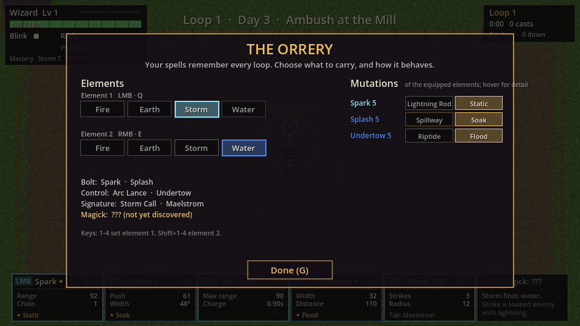
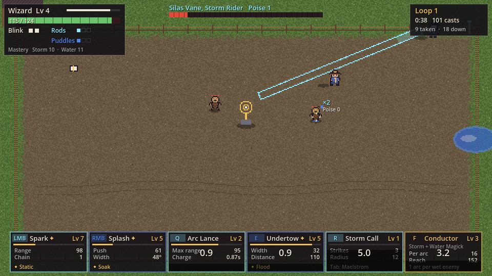

# Wizard: Readable Arsenal prototype

A small browser prototype of the wizard game, built from the "Readable Arsenal" design: four elements (**Fire, Earth, Storm, Water**) carried two at a time, two Magicks (**Meteor** and **Conductor**), one fight (**Ambush at the Mill**), pixel art, and progression you can see. Godot 4.7, GDScript, web export.



## Play it

- **In the browser:** every push to `main` publishes the web build to GitHub Pages (turn Pages on once: *Settings → Pages → Source: GitHub Actions*). Every PR also uploads the build as the `wizard-web` artifact; unzip it and run `python3 -m http.server` in the folder, then open http://localhost:8000.
- **In the editor:** open this folder in Godot 4.7 (standard edition) and press F5.
- **Export yourself:** `godot --headless --export-release "Web" export/web/index.html` (needs the 4.7.2 web export template).

## Controls

| Input | Slot |
| --- | --- |
| WASD | Move |
| Mouse | Aim |
| LMB / RMB | The **Bolt** of element 1 / element 2 |
| Q / E (hold, release) | The **Control** spell of element 1 / element 2 |
| R (hold, release) | **Signature** of either element. **Tab** swaps them |
| F (hold, release) | The **Magick** of the pair. Locked until you discover it |
| G | The **Orrery** shrine, while the yard is quiet and you stand by it |
| Space | Blink (charges grow with wizard level) |
| 1 / 2 | Pick a milestone mutation |
| F1 | Practice: every spell +1 level (to see milestones and mutations quickly) |
| F2 | Autoplay: a bot plays; press again to take over |

Holding Q, E, R or F shows the exact telegraph; the telegraph is the hitbox.

## The four elements

| Element | Bolt | Control | Signature | Field object |
| --- | --- | --- | --- | --- |
| **Fire** | Ember Bolt: adds a flame pip; 3 pips = **Ignite** | Pillar: a delayed fire column; adds 2 pips | Pyroclasm: bounces between pip-marked enemies | Embers (cap 6) |
| **Earth** | Pebble: heavy knockback; a hit drops a **lodestone** that orbits you | Fling: pushes your lodestones out in a cone | Avalanche: every lodestone slams one target | Lodestones (cap 3 to 7) |
| **Storm** | Spark: an instant zig-zag to the nearest enemy in a cone, then chains | Arc Lance: hold to charge a line (you move slowly), release to strike along it | Storm Call: strikes on circles around the aim; the last leaves a **rod** | Lightning rods (cap 3): each zaps a nearby enemy |
| **Water** | Splash: a short spray that pushes and makes enemies **Wet** | Undertow: a wave that carries enemies and leaves a **puddle** | Maelstrom: a whirlpool that pulls enemies together | Puddles (cap 3): standing in one makes you Wet |

Wet enemies show a blue drip. Lightning that touches a wet enemy chains one hop further.

| Pair | Magick | Discover it by |
| --- | --- | --- |
| Fire + Earth | **Meteor**: lodestones ignite and fall as fireballs | Fire touching a lodestone (catch one in a Pillar) |
| Storm + Water | **Conductor**: a chain arc runs through every wet enemy in reach | Lightning striking a wet enemy |

Other pairs (Fire + Storm, Earth + Water, and so on) work, but have no Magick in the prototype yet.



## The fight

Two waves of Dust Hollows (melee, red wedge telegraphs) and Hollow Slingers (red aim lines), then a duel with **Silas Vane, the Storm Rider**: a Spark skill shot, an Arc Lance line, Storm Call circles, and a blink out of your Pillars. At half HP he calls more Hollows. Win or fall, the **Loop Ledger** records the run and you wake again in the next loop.

## What to look for (the "readable" part)

- **Level-ups are visible.** A spell levels from its own hits. You get a toast with the stat change ("Speed 209 › 218"), the card flashes, and for the next few casts a dashed ghost shows the *old* size: an old-speed ghost bolt that the new one outruns, the old Pillar radius, the old Fling cone.
- **Milestones at 5, 10 and 15** pause the fight for a pick between two mutations. The card's name gets a star and lists the mutation. Ember Bolt usually reaches 5 in the first fight.
- **Field objects** are counted by your HP bar, one row per equipped element: lodestones (cap 3, Avalanche raises it to 7), embers (cap 6), rods (cap 3) and puddles (cap 3).
- **Impact vs Poise.** Hollows have Poise 0, Silas has Poise 1. Ember Bolt (Impact 1) only makes Silas show a small "x", Pebble (2) makes him flinch, Pillar (3) and a fully charged Arc Lance stagger him and break his wind-up; Updraft (4) knocks him down.
- **Enemy HP in chunks of 10.** Hovering an enemy shows hits-to-kill with your element-1 Bolt (×N).
- **Hit-stop and shake** scale with the share of the target's HP removed, not raw damage.
- **The loop as a measuring stick.** Spell levels, mutations, Magicks, tome hints and your loadout carry over; the wizard level drops to half. The Ledger lists every loop with the pair you carried and draws a sparkline of win times.

## The design decisions, as built

1. **Two elements equipped.** You start with Fire + Earth; Storm and Water wait at the Orrery.
2. **Wizard level halves each loop** (rounded down, minimum 1). Spells keep their levels.
3. **Elements and milestone picks change only at an Orrery shrine.** The Orrery stands in the middle of the yard. Press G beside it while the yard is quiet (before the first wave and between waves) to choose your two elements and re-pick any mutation of the spells you carry. There is no free re-pick at the start of a loop.
4. **Magicks: discovery in combat, with tomes as hints.** A Magick unlocks only when its two elements meet in a fight. A tome lies by the fence in each loop while there is a Magick you have neither discovered nor read about; walking over it gives a hint ("Storm finds water"), shown on the F card. Hints carry across loops; they never unlock the Magick themselves.

## Not in this prototype

Frost and Time, Magicks for the other pairs, relics and Focus, the town and the 28-day calendar, audio, and Silas as a full Storm kit (he only uses three of its moves). Three mutations differ from the design doc because the prototype has nothing for them to act on: Arc Lance's *Full charge pierces walls* is **Overcharge** (full charge deals double, the yard has no walls), Splash's *Spray heals ally echoes* is **Spillway** (Splash leaves a puddle, there are no echoes), and Maelstrom's *Combines with any Magick* counts everything in the whirlpool as wet for Conductor. All numbers are starting values in `data/spells.json`.

## Files

| File | What it does |
| --- | --- |
| `data/spells.json` | Every tuning number: elements, spells, stat tracks, milestones, Magicks, field objects, the shrine, enemies, reactions |
| `scripts/autoload/progression.gd` | Spell XP and levels, mutations and re-picks, mastery, the loadout, Magicks and tome hints, wizard level, loops, the Ledger, saving |
| `scripts/arena.gd` | The Mill fight: units, hits and reactions, pips and Ignite, Wet, projectiles, telegraphs, lodestones, the Orrery and tomes, drawing |
| `scripts/kit.gd` | The loadout: slots, input, casting, blink, hold-to-aim previews and level-up ghosts |
| `scripts/spells/fire_earth.gd` | Fire and Earth spells and Meteor |
| `scripts/spells/storm_water.gd` | Storm and Water spells, rods, puddles, the whirlpool and Conductor |
| `scripts/ai.gd` | Hollows, Slingers and Silas Vane |
| `scripts/hud.gd` | Spell cards, HP and caps, duel bar, toasts, milestone picker, the Orrery menu, title, Ledger |
| `scripts/pixel_art.gd` | Hand-placed pixel sprites and the yard, baked into textures at start |
| `scripts/bot.gd` | The bot used by the fight test and F2 autoplay |
| `tools/tests/` | `unit.gd` (progression rules) and `fight.gd` (the bot plays loop 1 as Fire + Earth, swaps to Storm + Water at the Orrery, and plays loop 2) |

Progress saves to `user://progress.json` (in the browser, the site's IndexedDB). Delete twice on the Ledger screen wipes it.

## Tests

```
godot --headless --script res://tools/tests/unit.gd
godot --headless --fixed-fps 60 --script res://tools/tests/fight.gd -- --loops 2
```

CI runs both on every PR (via `tools/ci/godot.sh`, which also fails on script errors) and builds the web export.
